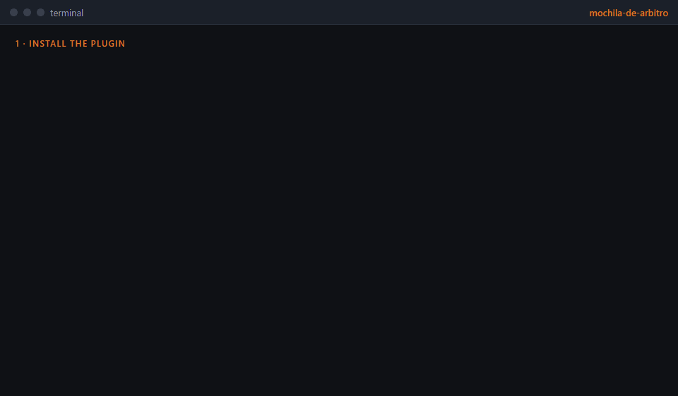

# Mochila de Árbitro

*A referee's kit for file provenance: an MCP server that proves where a file came from and when, locally and read-only.*

[Leia em português](README.pt-BR.md)



A referee observes, records and proves, without deciding for anyone. Mochila de Árbitro ("the referee's backpack") does the same with files: it tells you the exact content (SHA-256), when a photo was taken (EXIF) and in what order a day's photos happened. Everything runs on your machine, with no network and without writing anything.

It is for people who work in the field with a notebook: referees, volunteers, teachers, researchers, reporters.

## The three pieces

| MCP piece | name | what it does |
|---|---|---|
| tool | `selar` ("seal") | SHA-256, size, EXIF date and camera of a file |
| resource | `cronologia://{pasta}` ("chronology") | a folder's photos in the order they were taken, each with its seal |
| prompt | `registrar_o_dia` ("log the day") | the field-notebook method: time, fact, sealed photo, nothing invented |

The tool and the resource give the fish. The prompt teaches how to fish.

### Why the date comes from EXIF

A file's modified date changes whenever it is copied, downloaded or sent. It proves nothing. The EXIF date is written by the camera at the moment the photo is taken. When there is no EXIF (a screenshot, a text file), the seal says `"origem_da_data": "sem_exif"` and does not guess.

The field names in the output are in Portuguese: `arquivo` (file), `tamanho_bytes` (size), `data_exif` (EXIF date), `origem_da_data` (where the date came from).

## Install

### As a Claude Code plugin (recommended)

The plugin installs the server and a skill that teaches the agent when and how to use it. You need [uv](https://docs.astral.sh/uv/) on the machine; the first start downloads the two Python dependencies.

Claude Code 2.1.275 or later, in one step:

```
/plugin install mochila-de-arbitro --marketplace bruno-d-silveira/mochila-de-arbitro
```

Older versions, in two steps:

```
/plugin marketplace add bruno-d-silveira/mochila-de-arbitro
/plugin install mochila-de-arbitro@mochila-de-arbitro
```

Set the archive folder before opening Claude Code. Without it, the archive is the folder where Claude Code was opened.

```bash
export MOCHILA_ACERVO=/path/to/archive          # macOS / Linux
```

```powershell
$env:MOCHILA_ACERVO = "C:\path\to\archive"      # Windows PowerShell
```

To remove it: `/plugin uninstall mochila-de-arbitro`.

### Manually, in any MCP client

Requires Python 3.12+ and [uv](https://docs.astral.sh/uv/).

```bash
git clone https://github.com/bruno-d-silveira/mochila-de-arbitro
cd mochila-de-arbitro
uv sync
```

**Claude Code:**

```bash
claude mcp add mochila-de-arbitro -e MOCHILA_ACERVO=/path/to/archive -- uv --directory /path/to/mochila-de-arbitro run python -m mochila.servidor
```

**Claude Desktop** (`claude_desktop_config.json`), Cursor and other clients use the same command in their MCP config:

```json
{
  "mcpServers": {
    "mochila-de-arbitro": {
      "command": "uv",
      "args": ["--directory", "/path/to/mochila-de-arbitro", "run", "python", "-m", "mochila.servidor"],
      "env": { "MOCHILA_ACERVO": "/path/to/archive" }
    }
  }
}
```

## Use

Ask in plain language:

- *"Seal IMG_0405.jpg and tell me when it was taken."*
- *"Put today's photos in order."*
- *"Is this the same file I sent last week? Here is the old hash."*

Or call the `registrar_o_dia` prompt with a date to log a day as a field notebook.

## Example

```
cronologia://2026-11-28

taken at              sha256 (12)    file
2026:11:28 06:41:37   AFF26F3CEFCC   IMG_0398.jpg
2026:11:28 08:22:49   26E46CAE3585   IMG_0405.jpg
2026:11:28 11:05:12   0F857EA6F041   IMG_0412.jpg
no EXIF, no place on the timeline:
                      42BF1C97FFA4   screenshot.png   (sem_exif)
```

The demo above uses sample photos generated for it, never real files.

## Security

- **Read-only.** No piece writes, deletes or moves a file. The `selar` tool declares `readOnlyHint`.
- **Locked to the archive.** Paths with `../` or that leave `MOCHILA_ACERVO` are refused as an expected error, not a crash.
- **No network.** Nothing leaves the machine. Your files stay yours.

## Tests

```bash
uv run pytest -q
```

Test photos are generated on the fly, with and without EXIF. No real file goes into the tests.

## What is here and what is not

This is the open v1 of Mochila de Árbitro. The BRAIN engine, the film reel, the data lake, the fable, the memory-care track and the two-witness courier are separate works by the author and are **not** part of this repository or this license.

The idea of the backpack was born in April 2026, one morning at Joaquina beach in Florianópolis, and became an episode of the fable: [A Mochila do Árbitro](https://github.com/bruno-d-silveira/brain-project/blob/main/fabulas/s02e03_a_mochila_do_arbitro.md) (in Portuguese).

## License

[Apache-2.0](LICENSE). The name "Mochila de Árbitro" is not licensed (see [NOTICE](NOTICE)).
